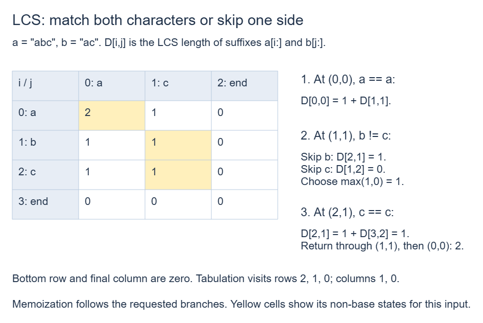

# Longest Common Subsequence

A common subsequence appears in both strings in the same character order, possibly with gaps. The longest common subsequence problem returns the maximum such length, rather than a substring or the subsequence itself. These implementations compare Unicode code points without normalization. See the [statement](QUESTION.md).

## How it works

Let `m` and `n` count code points in strings `a` and `b`. Define `best(i, j)` as the LCS length of suffixes starting at indices `i` and `j`. When either index reaches its string's end, the result is zero. If the current characters match, include that character and advance both indices. Otherwise, skip the current character from either string and choose the better result.

```c
best(i, j) {
    if (i == m || j == n) {
        return 0;
    }
    if (memo[i][j] == -1) {
        if (a[i] == b[j]) {
            memo[i][j] = 1 + best(i + 1, j + 1);
        } else {
            memo[i][j] = max(best(i + 1, j), best(i, j + 1));
        }
    }
    return memo[i][j];
}
```

Memoization initializes `m` independent rows with `n` entries of `-1`, then asks for `best(0, 0)`. The cache key needs both indices: changing either suffix can change the answer. A cached zero is a valid computed answer, not an uncomputed state. Each recursive call advances at least one index, so the dependency graph is acyclic. The code passes indices rather than constructing substring copies at every call.

Tabulation uses an extra all-zero row and column for empty suffixes. It fills rows from the end of `a` toward its beginning and columns from the end of `b` toward its beginning. The needed lower, right and diagonal entries are already available:

```c
for (i = m - 1; i >= 0; i--) {
    for (j = n - 1; j >= 0; j--) {
        if (a[i] == b[j]) {
            dp[i][j] = 1 + dp[i + 1][j + 1];
        } else {
            dp[i][j] = max(dp[i + 1][j], dp[i][j + 1]);
        }
    }
}
return dp[0][0];
```

For `a = "abc"` and `b = "ac"`, `(0, 0)` matches `a`, so it needs one plus `(1, 1)`. There, `b` differs from `c`: skipping `b` reaches `(2, 1)`, whose matching `c` contributes one; skipping `c` reaches an empty suffix and contributes zero. Returning gives `best(1, 1) = 1` and `best(0, 0) = 2`. Memoization computes only these three non-base states. Tabulation fills the whole rectangle, whose rows including the final boundary are `[2, 1, 0]`, `[1, 1, 0]`, `[1, 1, 0]`, `[0, 0, 0]`.



If leading characters differ, a common subsequence cannot pair those two positions, so an optimum must skip at least one of them; the maximum covers both possibilities. If they match, an optimum can include that leading character. Any optimum omitting both can be extended by it, and an optimum using a later occurrence on one side can move that match to the equal leading character without breaking order. The remaining matches then lie in both following suffixes. This proves the recurrence by induction on the combined suffix lengths.

## Costs and project code

For nonempty strings of `m` and `n` code points, both methods take `O(mn)` worst-case DP time and use `O(mn)` table storage. The cache is initialized densely even when only a narrow path is requested, so memoization does not save rectangular allocation here. Across empty-input cases, the universal bound is `O((m + 1)(n + 1))` time and space, including row objects and conversion buffers. Tabulation explicitly initializes `(m + 1)(n + 1)` entries. Python's memoized version can return immediately after allocating zero rows when `m = 0`; with `n = 0`, it still creates `m` empty rows.

Memoization adds `O(m + n + 1)` simultaneous recursive calls, since each edge advances one or both indices. The dense cache and stack together stay within the universal bound above. Long inputs can exceed recursion limits. Tabulation has constant call-stack depth. Neither method returns the LCS text, so result size is constant; reconstructing a sequence would require an additional traversal not implemented here.

Python indexes strings by code point. Go converts inputs to rune slices and TypeScript uses `Array.from`, adding `O(m + n)` work and storage for valid Unicode inputs. Those conversions prevent UTF-8 bytes or UTF-16 surrogate halves from becoming separate matches. In `"x😀y😀"` and `"😀😀"`, the length is two. A precomposed `"é"` and `"e\u0301"` share no equal code point and return zero; the code does not normalize or segment grapheme clusters. Go assumes valid UTF-8 and JavaScript assumes well-formed Unicode, as stated in the contract.

Code: [Go](golang/solution.go), [Python](python/solution.py), [TypeScript](typescript/index.ts). Tests explicitly enumerate subsequences and intersect the sets for every pair of binary-alphabet strings up to length four, then cover empty inputs, repeated characters, reversed order and Unicode: [Go tests](golang/solution_test.go), [Python tests](python/test_solution.py), [TypeScript tests](typescript/index.test.ts).
