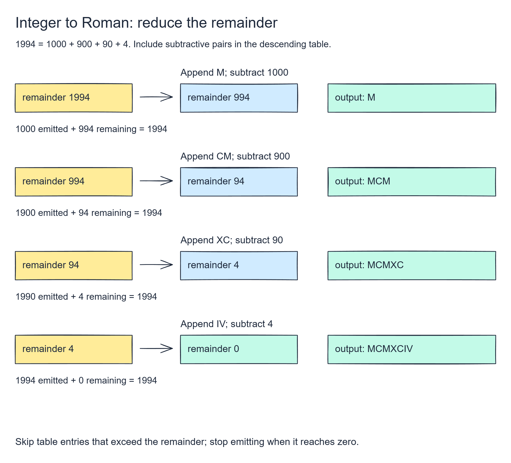

# Integer to Roman

Roman numeral conversion represents an integer from 1 through 3999 with the symbols `I`, `V`, `X`, `L`, `C`, `D` and `M`, including the subtractive pairs `IV`, `IX`, `XL`, `XC`, `CD` and `CM`. Return the numeral as a string. See the [problem statement](QUESTION.md).

## How it works

Keep matching value and symbol tables in descending order. Include the subtractive pairs as entries: 900 maps to `CM`, 400 to `CD`, and so on. For each entry, append its symbol while its value fits in the remaining number, subtracting that value after each append. Then continue to the next entry.



For 1994, append `M` and leave 994. Append `CM` and leave 94, then `XC` and leave 4. Append `IV` to finish with `MCMXCIV`. Skip entries larger than the remainder; you do not emit a symbol for them.

```c
intToRoman(num) {
    values = [1000, 900, 500, 400, 100, 90, 50,
              40, 10, 9, 5, 4, 1];
    symbols = ["M", "CM", "D", "CD", "C", "XC", "L",
               "XL", "X", "IX", "V", "IV", "I"];
    roman = "";
    for (i = 0; i < length(values); i++) {
        while (num >= values[i]) {
            roman += symbols[i];
            num -= values[i];
        }
    }
    return roman;
}
```

The emitted numeral's value plus the remainder equals the original input after each subtraction. Processing entries in this order applies the Roman rules for each decimal place: choose `IX` before repeating `V` and `I`, and `IV` before repeating `I` four times. This greedy choice depends on this table and these numeral rules; it is not a general rule for arbitrary denominations. At remainder zero, the emitted numeral represents the whole input.

## Costs and project code

The allowed input range bounds the table scans and output length, so time and auxiliary space are `O(1)` for this problem, including the bounded result. If you count emitted symbols, there are `k` appends. Immutable string concatenation may copy an existing prefix, but `k` remains bounded here.

Go and TypeScript use repeated subtraction. Python computes the number of repetitions for each entry with integer division, then appends and subtracts that many times. The implementations rely on the stated range; they do not validate arbitrary integers.

Code: [Go](golang/solution.go), [Python](python/solution.py) and [TypeScript](typescript/index.ts).

## Complexity derivation

The input contract is `1 <= num <= 3999`, the value table has 13 entries, and the result has bounded length. Consequently, both upper and lower time bounds are constant: `Θ(1)`, including construction of the result. Auxiliary and output space are also `Θ(1)` on this domain. A number's magnitude is not the same as the number of bits used to encode it; extending the domain would require choosing which input size to analyze.

For 1994, the four emitted tokens are `M`, `CM`, `XC`, `IV`, producing prefixes of lengths 1, 3, 5 and 7. Repeated immutable concatenation may copy those prefixes, but all remain bounded by the problem contract. With an unbounded extension and output length `q`, repeated copying could instead total `O(q²)` character work. That extension is not a bound on the current bounded problem. All three versions use loops and constant call-stack space.
