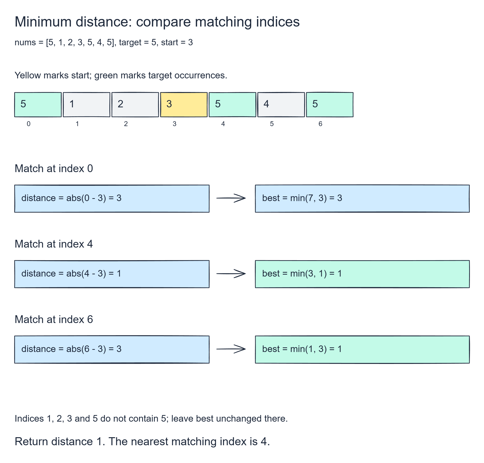

# Minimum Distance to the Target Element

Index distance measures how many positions separate two array indices: `abs(i - start)`. Find the smallest such distance among positions containing the target, which the problem guarantees exists. Return the distance, not the matching index. See the [problem statement](QUESTION.md).

## How it works

Scan the array and ignore values other than the target. At a match, compute its distance from `start` and keep the smaller of that distance and the best one so far. Initialize the best distance to the array length, which exceeds any valid index distance in a nonempty array.



For `[5, 1, 2, 3, 5, 4, 5]` with target 5 and start 3, the matching indices are 0, 4 and 6. Their distances are 3, 1 and 3, so the answer is 1. Taking the absolute value makes a match to the left comparable to one to the right.

```c
minDistance(nums, target, start) {
    best = length(nums);
    for (i = 0; i < length(nums); i++) {
        if (nums[i] == target) {
            distance = abs(i - start);
            best = min(best, distance);
        }
    }
    return best;
}
```

After each iteration, `best` is the minimum distance among matches in the processed prefix, or the initial sentinel if none has appeared. A match can lower that minimum; a nonmatch cannot affect it. After the last index, you have compared all target positions. A match at `start` gives zero, the smallest possible answer. A single-element valid input also returns zero.

## Costs and project code

The implementations scan `n` positions in `O(n)` time and keep `O(1)` auxiliary state. They preserve the input and continue scanning even after finding distance zero.

Go computes the absolute value with a sign check; Python and TypeScript use their standard absolute-value operation. If the target is absent, the implementations retain the initial array-length sentinel. That case is outside the problem's contract.

Code: [Go](golang/solution.go), [Python](python/solution.py) and [TypeScript](typescript/index.ts).

## Complexity derivation

Let `n` be the array length. Each version compares exactly `n` positions with the target and does constant extra work at a match. Thus both best-case and worst-case time are `Θ(n)` for nonempty input. A match at `start` yields the smallest possible distance but does not stop these implementations. For `[5, 1, 2, 3, 5, 4, 5]`, target 5 and start 3, the running best changes from 7 to 3 at index 0, then to 1 at index 4, and remains 1 at index 6.

The current index, distance and minimum occupy `Θ(1)` auxiliary space; the scalar result and call stack are constant-sized too. There is no hashing, recursion, slicing or growing result to add a hidden cost. Empty input would return the zero-length sentinel, but falls outside the statement's guaranteed valid start and present target.
