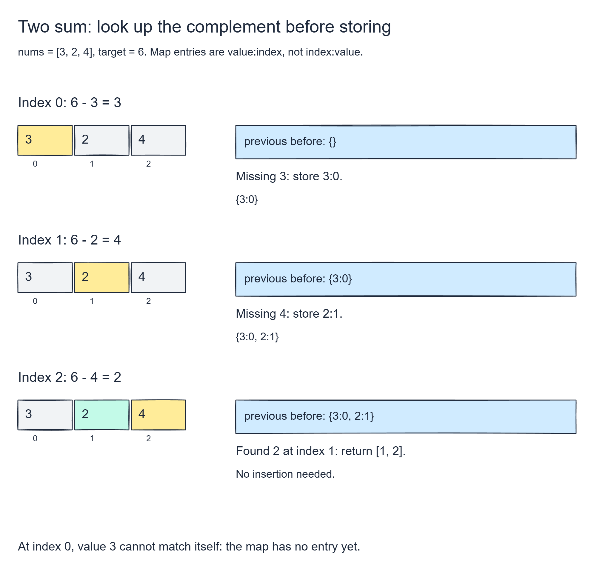

# Two Sum

The two-sum problem asks for two distinct indices whose values add up to a target. Return the indices, preserving the original array's indexing. The problem guarantees one valid pair. See the [problem statement](QUESTION.md).

## How it works

Scan the array and keep a hash map from previously visited values to their indices. For the current value `x`, compute `target - x`. If that complement is in the map, return its saved index and the current index. Otherwise, store `x` with the current index and continue.



For `[3, 2, 4]` and target 6, index 0 needs another 3. The empty map has none, so store `3:0`. At index 1, look for 4 and then store `2:1`. At index 2, look for 2 and find index 1. Return `[1, 2]` because `nums[1] + nums[2] = 2 + 4 = 6`.

```c
twoSum(nums, target) {
    previous = hashMap();
    for (i = 0; i < length(nums); i++) {
        complement = target - nums[i];
        if (previous.contains(complement)) {
            return [previous[complement], i];
        }
        previous[nums[i]] = i;
    }
    return [];
}
```

Check before inserting so the current index cannot match itself. With `[3, 3]` and target 6, the first 3 enters the map, and the second finds it. Before each lookup, stored indices all precede the current index. When you reach the later index of a valid pair, the map already contains its complement. Keeping one index per value is enough to return a pair, even if another occurrence overwrites an earlier index.

## Costs and project code

For `n` elements and expected constant-time hash operations, time is `O(n)` expected and auxiliary space is `O(n)`. The implementations do not sort or modify the input.

Go returns `nil` if no pair exists; Python and TypeScript return empty lists or arrays. That fallback lies outside the promised one-pair inputs. Test map membership rather than treating the saved index as a boolean: index zero is a valid match.

Code: [Go](golang/solution.go), [Python](python/solution.py) and [TypeScript](typescript/index.ts).

## Complexity derivation

Let `n` be the array length and `p` the number of positions processed before a pair is returned. Each position performs constant arithmetic and a bounded number of map operations. Time is expected `Θ(p)` under constant expected hash costs, and map storage is `O(p)` entries. On `[3, 2, 4]`, target 6, the stored states are `{3:0}`, then `{3:0, 2:1}`; the third lookup finds 2 and returns without another insertion.

For valid arrays of length at least two, a pair in the first two positions gives best-case `Θ(1)` time. A pair requiring the final position gives expected worst-input-case `Θ(n)` time and can retain `Θ(n)` distinct keys. With linear-cost collision handling, the scan instead has an `O(n²)` worst-case upper bound under that model. The two-index output and call stack use `Θ(1)` space. No sorting or recursive search occurs, and map lookup must distinguish an absent key from a stored index zero.
