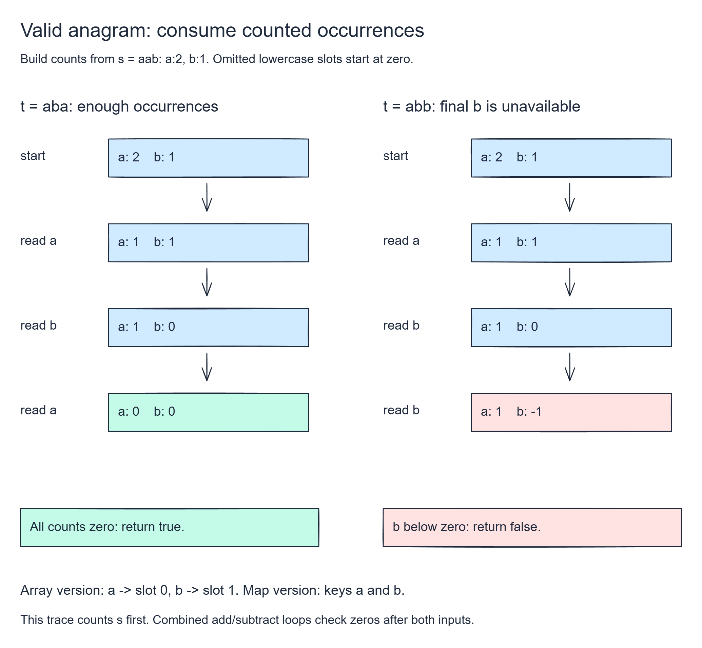

# Valid Anagram

Two strings are anagrams when they contain the same characters with the same multiplicities, regardless of order. Decide whether the two input strings satisfy that condition. The core problem uses lowercase English letters. See the [problem statement](QUESTION.md).

## How it works

Reject unequal lengths first. Count the characters in `s`, then subtract one occurrence for each character in `t`. If you need a character whose remaining count is zero, return false. After consuming equal-length strings without exceeding a count, you have matched every occurrence.



For `s = "aab"` and `t = "aba"`, start with `a:2, b:1`. Reading `a`, `b`, `a` leaves `a:0, b:0`. For `t = "abb"`, the final `b` needs a second occurrence that `s` does not contain. Equal length alone cannot detect that mismatch.

```c
isAnagram(s, t) {
    if (length(s) != length(t)) {
        return false;
    }
    counts = array(26, 0);
    for (i = 0; i < length(s); i++) {
        counts[s[i] - 'a']++;
    }
    for (i = 0; i < length(t); i++) {
        slot = t[i] - 'a';
        counts[slot]--;
        if (counts[slot] < 0) {
            return false;
        }
    }
    return true;
}
```

The fixed-array approach in `solution_1` assigns one slot per lowercase letter. Python follows the two counting phases above. Go and TypeScript add from `s` and subtract from `t` in the same loop, then check that all slots equal zero. Their intermediate counts can be negative before later additions, so they wait until the end to reject a nonzero count.

The map approach in `solution_2` uses characters as keys. First count `s`; then decrement as you consume `t`, rejecting a missing or exhausted character. A missing key has count zero. This approach supports alphabets beyond 26 letters without allocating a slot for each possible character. In either approach, the final count for a character is its number of occurrences in `s` minus its number in `t`. Zero differences prove the anagram condition. Two empty strings also satisfy it.

## Costs and project code

For strings of length `n`, both approaches take `O(n)` time, with expected hash-operation costs for the map. The fixed array uses `O(26) = O(1)` auxiliary space. The map uses `O(u)` space for `u` distinct characters, also bounded by 26 under the core problem's alphabet. Neither approach changes the inputs.

For the Unicode follow-up, define what counts as a character. Python iterates code points; Go's map version iterates runes but checks byte lengths first; TypeScript iterates code points with `for...of` but checks UTF-16 lengths first. These versions count code points without normalization or grapheme segmentation. For inputs using different representations of the same visible text, normalize and count in the chosen unit before applying this approach.

Array code: [Go](solution_1/golang/solution.go), [Python](solution_1/python/solution.py) and [TypeScript](solution_1/typescript/index.ts).

Map code: [Go](solution_2/golang/solution.go), [Python](solution_2/python/solution.py) and [TypeScript](solution_2/typescript/index.ts).

## Complexity derivation

Let `n` be the common string length after the length check, and `u` the number of distinct characters stored by the map version. A length mismatch returns in `Θ(1)` time because these string types store their lengths. For equal-length nonempty inputs, the array versions take `Θ(n)` time even on an early mismatch: Python counts all of `s` before testing `t`, while Go and TypeScript process both strings fully before checking their 26 counters. The equal-length map versions likewise first count all of `s`, so take expected `Θ(n)` time under expected constant map access.

For `s = "aab"` and `t = "aba"`, Python's subtracting pass changes `(a:2,b:1)` to `(a:1,b:1)`, `(a:1,b:0)`, then `(a:0,b:0)`. Go and TypeScript's fixed arrays interleave additions and subtractions, yielding a different intermediate trace with the same final differences. Neither approach sorts or copies the input strings.

The fixed array takes `Θ(26) = Θ(1)` space. The map takes `Θ(u)` entries, bounded by 26 under the lowercase-English contract. Under that fixed alphabet, collision chains cannot grow with `n`; for an expanded alphabet with growing `u`, expected lookup assumptions matter and a linear-chain model can raise time to `O(nu)`. All variants use `Θ(1)` call-stack space. The Unicode discussion above concerns behavior as well as cost: string length and iteration do not always count the same character unit across languages.
