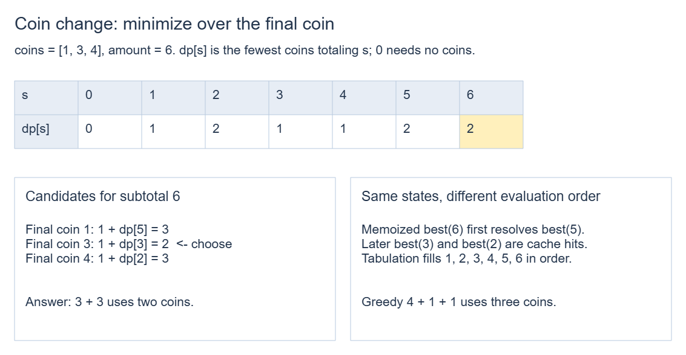

# Coin Change

Coin change finds the minimum number of coins summing to an exact nonnegative amount, with unlimited reuse of each positive denomination. Return that minimum or `-1` when no combination exists. An amount of zero needs zero coins. See the [statement](QUESTION.md).

## How it works

Define `best(r)` as the minimum number of coins for remaining amount `r`, with `best(0) = 0`. If a final coin has value `c <= r`, the preceding coins must sum to `r - c`; that candidate uses `1 + best(r - c)` coins. Choose the minimum over all denominations whose preceding amount is reachable. Positive denominations make every dependency strictly smaller, ensuring termination. Zero or negative denominations are rejected rather than creating nondecreasing dependencies.

Let `A` be the requested amount. Any successful combination uses at most `A` coins, since each coin is at least one. Thus `A + 1` is an internal unreachable sentinel. It differs from `-1`, which marks an uncomputed memo entry. The public `-1` result is produced only when the final answer is the unreachable sentinel. Unreachable child answers are skipped before adding one.

```c
best(r) {
    if (memo[r] != -1) {
        return memo[r];
    }
    result = unreachable;
    for (coin in coins) {
        if (coin <= r) {
            previous = best(r - coin);
            if (previous != unreachable) {
                result = min(result, 1 + previous);
            }
        }
    }
    memo[r] = result;
    return result;
}
```

The memoized wrapper creates a fresh cache and sets `memo[0] = 0`. It asks for `best(A)` and recursively resolves only the required states, saving both successful and unreachable answers. Caching failures matters: multiple branches may reach the same impossible remainder.

Tabulation initializes `dp[0] = 0` and every other entry to `A + 1`. It visits subtotals from one through `A`, using the same candidate rule against already completed entries:

```c
for (subtotal = 1; subtotal <= A; subtotal++) {
    for (coin in coins) {
        if (coin <= subtotal && dp[subtotal - coin] != unreachable) {
            dp[subtotal] = min(dp[subtotal], 1 + dp[subtotal - coin]);
        }
    }
}
```

For denominations `[1, 3, 4]` and amount 6, the finished entries are `[0, 1, 2, 1, 1, 2, 2]`. At subtotal 6, the candidates are `1 + dp[5] = 3`, `1 + dp[3] = 2` and `1 + dp[2] = 3`; choose two coins of value three. With this denomination order, memoization first resolves the remainder-five branch, then later requests cached remainders three and two.



Every nonempty exact combination has a final coin. Removing it yields one of the smaller states considered, so the recurrence misses no valid candidate. Conversely, adding a coin to a reachable predecessor forms an exact combination. Taking the minimum over these choices proves optimality by induction on the amount. Choosing the largest available coin greedily would instead produce `4 + 1 + 1` here, which uses more coins.

## Costs and project code

Let `k` be the number of denomination entries and `A` the target amount. Validation takes `O(k)` time, and allocating and initializing the cache or table takes `Θ(A + 1)`. Each of at most `A` positive states scans all `k` entries, giving `O((A + 1)(k + 1))` overall time and `Θ(A + 1)` table space. With positive `A` and nonempty denominations, tabulation takes `Θ(Ak + A + k)` time. Memoization may evaluate fewer states but still allocates the full array. Duplicate denominations repeat candidate work without changing the minimum, so they still count toward `k`.

Memoization can create `O(A + 1)` simultaneous calls, for example when denomination one is present and explored first. Its stack can exhaust a language's recursion limit for large valid amounts. Tabulation uses constant stack space. Both return a scalar, preserve the input list and allocate a fresh table per call. The dependence on numeric amount, rather than its binary encoding length, makes this a pseudopolynomial algorithm.

An empty denomination list returns zero for amount zero and `-1` otherwise. Denominations larger than the target are skipped. Validation rejects nonpositive coins even when amount zero would not need them. Go panics for invalid numeric domains and Python/TypeScript raise `ValueError`/`RangeError`; the latter also checks safe integer inputs. Go and TypeScript reject the largest representable target so `A + 1` remains representable. The tables must fit available memory; validation does not impose an arbitrary memory limit.

Code: [Go](golang/solution.go), [Python](python/solution.py), [TypeScript](typescript/index.ts). Tests compare both approaches with BFS over reachable sums for every subset of denominations 1 through 5 and amounts 0 through 19, then check duplicates, reuse, cache isolation and invalid inputs: [Go tests](golang/solution_test.go), [Python tests](python/test_solution.py), [TypeScript tests](typescript/index.test.ts).
