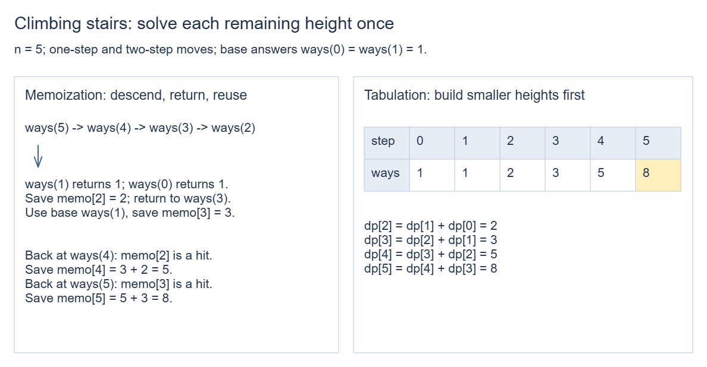

# Climbing Stairs

Climbing stairs counts ordered sequences of one-step and two-step moves that reach exactly `n` stairs. Return the number of sequences, including one empty sequence when `n = 0`. The [statement](QUESTION.md) restricts `n` to integers from 0 through 45 so all three languages can represent the answer exactly, including Go on 32-bit targets.

## How it works

Define `ways(r)` as the number of ways to climb `r` remaining stairs. There is one way to climb zero or one stair. For `r >= 2`, partition all possible sequences by their first move: a one-step move leaves `r - 1`, and a two-step move leaves `r - 2`. The sets are disjoint and contain every valid sequence, so `ways(r) = ways(r - 1) + ways(r - 2)`.

Without stored answers, this recursion would repeatedly solve the same remaining height. **Memoization** computes a state on demand and saves it before returning. Here an array entry of `-1` means not computed; a cached count is positive. The recursive base cases return directly, so memo entries zero and one remain `-1` in the actual code.

```c
ways(r) {
    if (r <= 1) {
        return 1;
    }
    if (memo[r] == -1) {
        memo[r] = ways(r - 1) + ways(r - 2);
    }
    return memo[r];
}
```

For `n = 5`, descend through states 5, 4, 3 and 2. States 1 and 0 return one each, so save `memo[2] = 2`. Returning to state 3 adds that result to base state 1 and saves 3. State 4 then uses the cached answer for state 2 to save 5. Finally state 5 uses cached state 3 to save 8. The cache is local to this invocation, so a later call cannot reuse answers from another problem instance.



**Tabulation** evaluates the same recurrence in a dependency order, without recursive calls. Initialize the base answers, then fill heights from two upward. Before writing `dp[r]`, both preceding answers are already correct. Python and TypeScript initialize the whole array with ones and replace entries from index two onward; Go starts with `dp[0] = 1`, copies the preceding answer at each step and adds the two-step contribution where it exists. The completed table is identical.

```c
dp[0] = 1;
if (n >= 1) {
    dp[1] = 1;
}
for (r = 2; r <= n; r++) {
    dp[r] = dp[r - 1] + dp[r - 2];
}
return dp[n];
```

The table for `n = 5` is `[1, 1, 2, 3, 5, 8]`. Induction on remaining height proves both methods correct: their base cases count the empty or single move, and every larger state sums the two disjoint first-move choices using correct smaller answers. This counts `[1, 2]` and `[2, 1]` separately.

## Costs and project code

Treating `n` as a varying parameter, both versions take `Θ(n + 1)` time and store `Θ(n + 1)` array entries. Memoization adds `O(n + 1)` call-stack space; tabulation uses constant call-stack space. Each non-base state is evaluated once, with constant work and at most two child requests. Cache hits do not expand another recursion tree. These implementations keep the full table; they do not use a two-counter space optimization.

Strictly, the enforced finite domain `0 <= n <= 45` bounds time and space by constants. The linear formulas describe how the code's state count grows within that domain. Removing the bound would also require accounting for growing integer values and representational limits. At `n = 45`, the answer is 1,836,311,903.

Invalid sizes panic in Go, raise `ValueError` in Python and throw `RangeError` in TypeScript. Python also rejects booleans and nonintegers; TypeScript rejects nonintegers and nonfinite numbers. Neither version constructs or returns the actual move sequences.

Code: memoized and tabulated approaches in [Go](golang/solution.go), [Python](python/solution.py) and [TypeScript](typescript/index.ts). Tests verify the full supported range against a separate combinatorial count: if a sequence has `k` two-step moves, it has `n - k` total moves and `C(n - k, k)` ways to place the two-step ones. Summing over `k` checks the result without using the DP recurrence: [Go tests](golang/solution_test.go), [Python tests](python/test_solution.py), [TypeScript tests](typescript/index.test.ts).
