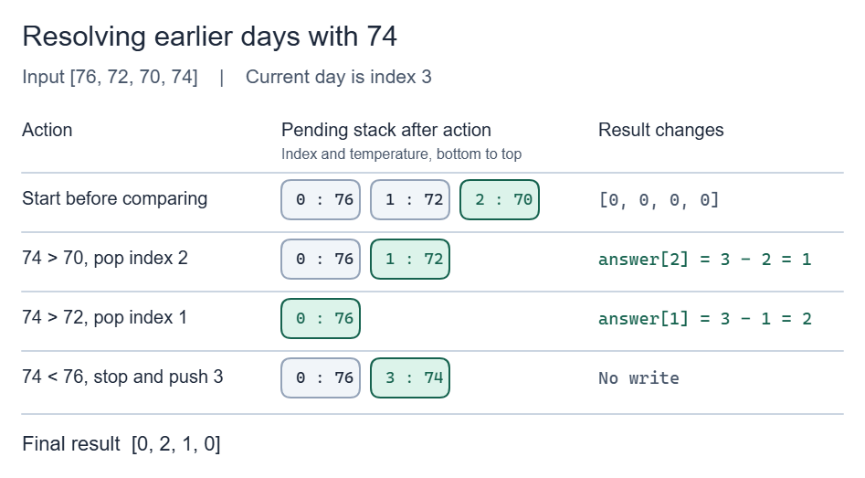

# Daily Temperatures

Given an array of daily temperatures, return the number of days each day has to wait for its first strictly warmer day. Use `0` when there is no warmer day later in the array. See the [problem statement](QUESTION.md).

## How it works

Scan the temperatures from left to right. Keep a stack of indices for days that are still waiting. An index lets you look up the temperature for comparison and subtract the two positions to get the number of days between them.

For each day `i`, compare its temperature with the temperature at the top of the stack. While the current day is warmer, write `i - previous` to `answer[previous]`, where `previous` is the top index. Pop that index and compare the same current day with the new top. Once the stack is empty or the current day is cooler than or equal to the top, push `i` and move to the next day.

For `[76, 72, 70, 74]`, the first three days leave indices `[0, 1, 2]` on the stack. Day `3` resolves day `2` with a wait of `1` and day `1` with a wait of `2`. The comparison with day `0` stops the loop because `74 < 76`. Push index `3`. The two indices still on the stack keep their initial zeros, giving `[0, 2, 1, 0]`.



```c
dailyTemperatures(temperatures) {
    n = length(temperatures);
    answer = array(n, 0);
    stack = [];

    for (i = 0; i < n; i++) {
        while (!empty(stack) && temperatures[i] > temperatures[top(stack)]) {
            previous = top(stack);
            answer[previous] = i - previous;
            pop(stack);
        }
        push(stack, i);
    }

    return answer;
}
```

Before processing each day, the stack holds exactly the earlier days whose answers are still pending. Their temperatures are in nonincreasing order from bottom to top. When the current temperature fails to beat the top, every temperature below it is at least as high, so it is safe to stop. The top that remains is at least as warm as the current day, so pushing the current index preserves the order. This is a [monotonic stack](../../concepts/algorithms/theory/monotonic_stack/Monotonic%20Stack.md).

Every popped index gets its first warmer day because we scan in chronological order and it was still waiting when the current day arrived. Equal temperatures leave both days pending until a strictly warmer day appears. For a single day, the stack holds that day at the end, so the result is `[0]`.

## Costs and project code

For `n` days, the outer loop makes `n` pushes. The inner loop performs at most `n` pops across the entire scan, plus at most one stopping check per day. Accounting for amortized stack growth, total time is `O(n)`.

The stack uses `O(n)` auxiliary space in the worst case, such as when the temperatures never increase. The output uses `O(n)` space.

Implementations in [Go](golang/solution.go), [Python](python/solution.py), and [TypeScript](typescript/index.ts).
