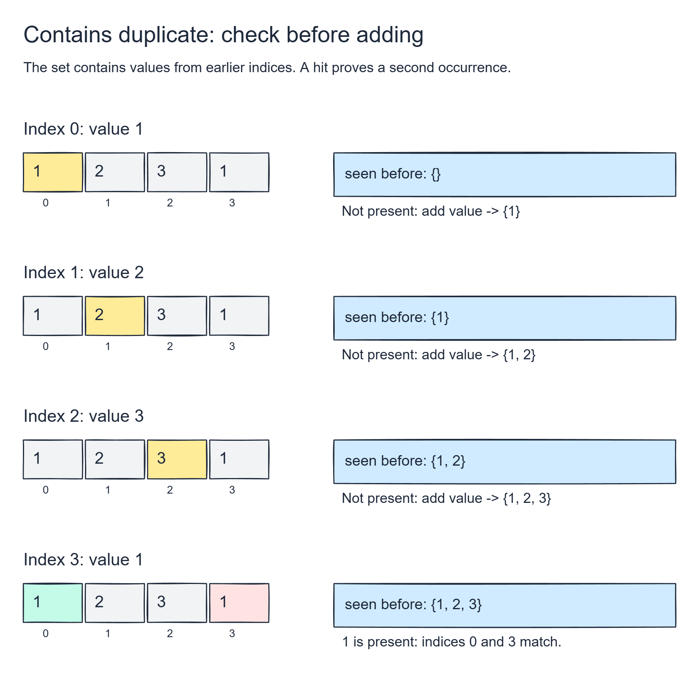

# Contains Duplicate

The duplicate-detection problem asks whether an integer occurs more than once in an array. Return a boolean; you do not need to collect duplicates or change the input. See the [problem statement](QUESTION.md).

## How it works

Scan from left to right and keep a hash set of values from earlier positions. Before adding the current value, check whether you have seen it. A match proves that two distinct positions contain the same integer, so return true. If you finish the scan, return false.



For `[1, 2, 3, 1]`, add the first three values. At index 3, find `1` in the set and return true. The set at that point describes indices 0 through 2. Negative numbers and zero use the same membership check.

```c
containsDuplicate(nums) {
    seen = hashSet();
    for (i = 0; i < length(nums); i++) {
        if (seen.contains(nums[i])) {
            return true;
        }
        seen.add(nums[i]);
    }
    return false;
}
```

Before each iteration, `seen` contains the distinct values in the processed prefix. Adding a new value preserves that condition. Finding an existing value provides both occurrences: one in the prefix and one at the current index. Empty and single-element arrays finish without a match.

## Costs and project code

With expected constant-time hash operations, scanning `n` elements takes `O(n)` expected time and uses `O(n)` auxiliary space. A duplicate near the beginning lets you stop before scanning the rest.

Python and TypeScript use sets. Go stores counts in a map and returns true when a count exceeds one; it detects the same second occurrence. None of the implementations modifies the input.

Code: [Go](golang/solution.go), [Python](python/solution.py) and [TypeScript](typescript/index.ts).
