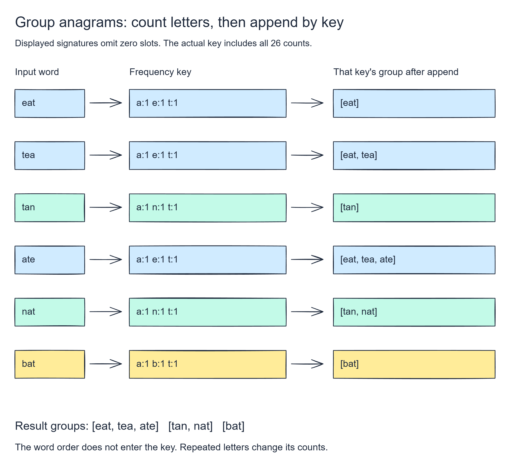

# Group Anagrams

An anagram group contains strings with the same letters and the same number of occurrences of each letter. Here, partition the input into such groups, retaining repeated strings as separate entries. Group order does not matter. See the [problem statement](QUESTION.md).

## How it works

For each word, create 26 zero counters, one for each lowercase English letter. Increment the slot at `letter - 'a'`. Use the complete counter sequence as a hash-map key and append the original word to that key's group.



For `eat`, `tea` and `ate`, the nonzero counters are `a:1, e:1, t:1`. Their order in the word changes, but their signature stays the same. `tan` and `nat` share another signature. The diagram omits zero slots for readability; the implementation includes all 26 positions in each key.

```c
groupAnagrams(words) {
    groups = hashMap();
    for (i = 0; i < length(words); i++) {
        counts = array(26, 0);
        for (j = 0; j < length(words[i]); j++) {
            counts[words[i][j] - 'a']++;
        }
        key = immutableKey(counts);
        if (!groups.contains(key)) {
            groups[key] = [];
        }
        groups[key].append(words[i]);
    }
    return groups.values();
}
```

Two words are anagrams exactly when their counts match at each letter. After processing a prefix of the input, each word in that prefix belongs to its signature's group. Appending the next word preserves that grouping. Empty strings share the all-zero signature; repeated strings append another entry to the same group.

## Costs and project code

For `n` words containing `L` letters in total, counting and constructing fixed-size keys takes `O(L + 26n)` expected time. The map uses `O(26g)` key storage for `g` groups; the result stores `O(n)` word references or string descriptors. These counts exclude the existing character storage of the input strings.

Go uses a comparable `[26]int` key, Python a tuple, and TypeScript a string joining the counts with `#`. The separator keeps sequences such as `1, 11` and `11, 1` distinct. A fresh array object would compare by identity as a TypeScript map key, so it would not group equal counts. The implementations assume lowercase English letters.

Code: [Go](golang/solution.go), [Python](python/solution.py) and [TypeScript](typescript/index.ts).
