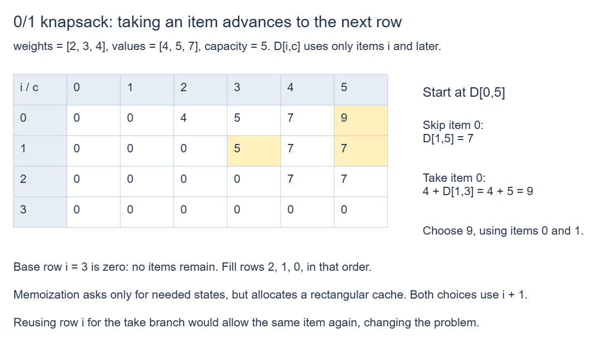

# 0/1 Knapsack

The 0/1 knapsack problem chooses a subset of items with maximum total value subject to a weight capacity. Each item index may be chosen at most once. Given positive integer weights, nonnegative integer values and a nonnegative capacity, return only the maximum value; selecting no items is allowed. See the [statement](QUESTION.md).

## How it works

Define `best(i, c)` as the largest value obtainable from item indices `i` and later with remaining capacity `c`. The index is necessary: capacity alone cannot describe which items remain available. Once `i` reaches the number of items `n`, return zero. Otherwise, skip item `i`, or take it if its weight fits. Both choices move to `i + 1`, which prevents item reuse.

```c
best(i, c) {
    if (i == n) {
        return 0;
    }
    if (memo[i][c] == -1) {
        result = best(i + 1, c);
        if (weights[i] <= c) {
            result = max(result, values[i] + best(i + 1, c - weights[i]));
        }
        memo[i][c] = result;
    }
    return memo[i][c];
}
```

Memoization creates independent cache rows filled with `-1`, then requests `best(0, capacity)`. Nonnegative valid answers, including zero, differ from the uncomputed sentinel. Every state is evaluated at most once; later requests return the stored optimum. Rows must be separate arrays, since changing one item's answers must not modify another row.

Tabulation makes the no-items row `dp[n][c] = 0` for every capacity, then fills item rows from `n - 1` down through zero. At each capacity it considers the same skip and take branches from the next row:

```c
for (i = n - 1; i >= 0; i--) {
    for (c = 0; c <= capacity; c++) {
        dp[i][c] = dp[i + 1][c];
        if (weights[i] <= c) {
            dp[i][c] = max(dp[i][c], values[i] + dp[i + 1][c - weights[i]]);
        }
    }
}
return dp[0][capacity];
```

For weights `[2, 3, 4]`, values `[4, 5, 7]` and capacity 5, the base row is all zero. The row for item 2 is `[0, 0, 0, 0, 7, 7]`. Including item 1 produces `[0, 0, 0, 5, 7, 7]`. At `best(0, 5)`, skipping gives 7, while taking the weight-two item gives `4 + best(1, 3) = 4 + 5 = 9`. The final row is `[0, 0, 4, 5, 7, 9]`.



Any feasible subset either excludes item `i`, leaving the first branch, or includes it once and leaves capacity `c - weights[i]` for later items. These cases exhaust the choices. Using the best later subset in each case and taking their maximum yields the optimum by induction on the number of remaining items. Reusing row `i` for the take branch would permit choosing the same item again and solve a different, unbounded-knapsack problem. For one weight-two, value-three item with capacity four, the correct result is three.

## Costs and project code

Let `n` count items and `W` be capacity. Each of `n(W + 1)` item/capacity states does constant work. Both methods have worst-case `O((n + 1)(W + 1))` time and auxiliary storage, which also covers empty inputs and the boundary row. More precisely, memoization allocates `n` rows of `W + 1` entries and uses `O(n + 1)` recursive frames; tabulation allocates `n + 1` rows and uses constant call-stack space. With no items, memoization returns after constant-size setup, while tabulation still initializes its `W + 1` boundary entries. Memoization's rectangular allocation occurs even if relatively few states are requested.

Capacity zero yields zero because weights are positive. Empty arrays, zero-valued items and items heavier than capacity also work. Equal-weight equal-value entries at different indices remain separate items. Input arrays are preserved; neither approach reconstructs the selected subset. The numeric dependence on `W` makes the bound pseudopolynomial relative to a binary-encoded capacity. A large number of items can exceed recursion limits in the memoized version even when the table would otherwise fit memory.

Invalid lengths or numeric domains panic in Go, raise `ValueError` in Python and throw `RangeError` in TypeScript. Go also checks that the sum of all values fits `int`; TypeScript checks that it is a safe integer, ensuring every candidate sum remains exact. Their accepted range is therefore based on all item values, even if some items could never fit. Python uses arbitrary-precision integers; the stated operation counts assume constant-time scalar arithmetic, so very large Python values add bit costs. Allocation sizes must fit memory, and these routines do not impose a separate resource budget.

Code: [Go](golang/solution.go), [Python](python/solution.py), [TypeScript](typescript/index.ts). Tests compare against explicit enumeration of every subset over 81 four-item weight combinations and capacities zero through eight. They also check forbidden reuse, duplicate items, zero values, empty inputs, preservation and validation: [Go tests](golang/solution_test.go), [Python tests](python/test_solution.py), [TypeScript tests](typescript/index.test.ts).
