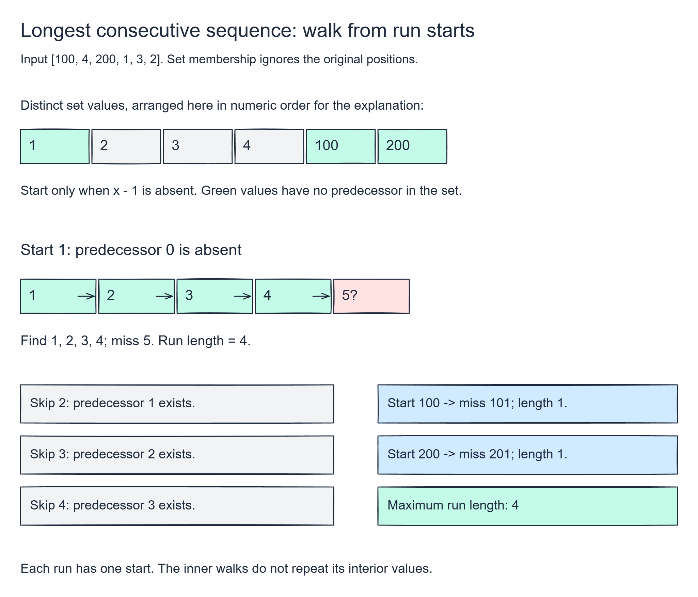

# Longest Consecutive Sequence

A consecutive sequence contains integers that increase by one, such as `1, 2, 3, 4`. Find the largest number of distinct values in such a sequence, regardless of their positions in the input. Return its length. See the [problem statement](QUESTION.md).

## How it works

Put the input values in a hash set to support membership checks and remove duplicates. For a value `x`, begin a sequence only if `x - 1` is absent. Then count `x`, `x + 1`, and subsequent values until the next integer is missing. Keep the largest count.



For `[100, 4, 200, 1, 3, 2]`, the start values are 100, 200 and 1. From 1, find 2, 3 and 4, then stop at missing value 5. Skip starting walks from 2, 3 and 4 because each has a predecessor. You may inspect the set in any order and obtain length 4.

```c
longestConsecutive(nums) {
    values = hashSet(nums);
    longest = 0;
    for (x in values) {
        if (!values.contains(x - 1)) {
            length = 0;
            while (values.contains(x + length)) {
                length++;
            }
            longest = max(longest, length);
        }
    }
    return longest;
}
```

Each finite run has one smallest value whose predecessor is absent. Starting there counts the full run. Starting at an interior value would repeat work, so the predecessor check excludes it. Since you inspect all possible starts, the largest count covers the longest run. An empty input returns zero. Duplicate values do not extend a run.

## Costs and project code

Building the set and checking potential starts takes `O(n)` expected time. Across the inner loops, you visit each distinct value once as part of its run, plus one failed membership check per run. The nested loops therefore take `O(n)` total expected time, with `O(n)` auxiliary space.

All three implementations use this approach and preserve the input. The problem's integer bounds keep the neighboring values within the supported numeric range of these implementations.

Code: [Go](golang/solution.go), [Python](python/solution.py) and [TypeScript](typescript/index.ts).
