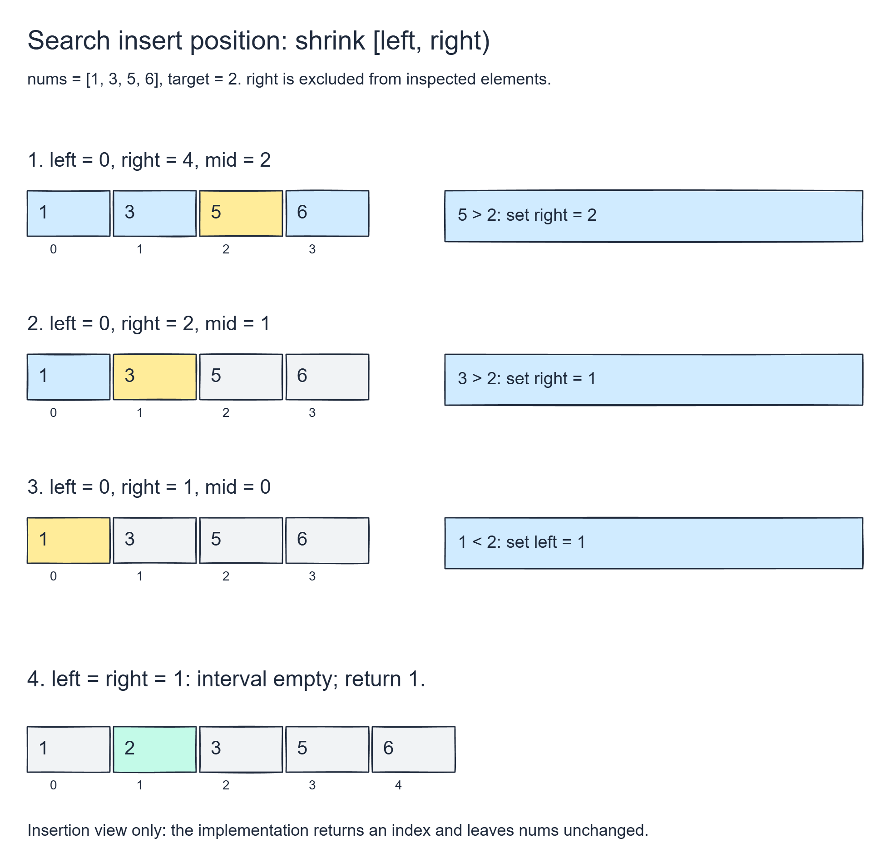

# Search Insert Position

An insertion position is an index where you can place a value while preserving ascending order. For this problem's sorted array of distinct integers, return the target's index if present, or its insertion position if absent. See the [problem statement](QUESTION.md).

## How it works

Use binary search with `left = 0` and `right = length(nums)`. Inspect elements in the half-open interval `[left, right)`. At each step, compare the middle value with the target. Return the middle index on equality. If the value is smaller, set `left = mid + 1`; otherwise set `right = mid`.



For `[1, 3, 5, 6]` and target 2, inspect index 2: value 5 is too large, so move `right` to 2. Inspect index 1: value 3 is too large, so move `right` to 1. Inspect index 0: value 1 is too small, so move `left` to 1. Both bounds now equal the insertion index, between 1 and 3.

```c
searchInsert(nums, target) {
    left = 0;
    right = length(nums);
    while (left < right) {
        mid = left + floor((right - left) / 2);
        if (nums[mid] == target) {
            return mid;
        }
        if (nums[mid] < target) {
            left = mid + 1;
        } else {
            right = mid;
        }
    }
    return left;
}
```

Values before `left` are smaller than the target; values from `right` onward are larger. The insertion position remains between the bounds, including the right boundary even though you never inspect it as an element of the current interval. Each comparison preserves those facts and reduces the number of unchecked elements. On termination, return their shared boundary. A target below the minimum returns 0; one above the maximum returns `n`. The code also returns 0 for an empty array.

## Costs and project code

Binary search takes `O(log n)` time for nonempty arrays and `O(1)` auxiliary space. The implementations preserve the array. They require the sorted-input contract; the discard decisions do not hold for arbitrary input order.

Go and TypeScript use the difference-based midpoint in the pseudocode. Python uses integer division of `low + high`, which is safe with Python's arbitrary-precision integers.

Code: [Go](golang/solution.go), [Python](python/solution.py) and [TypeScript](typescript/index.ts).
