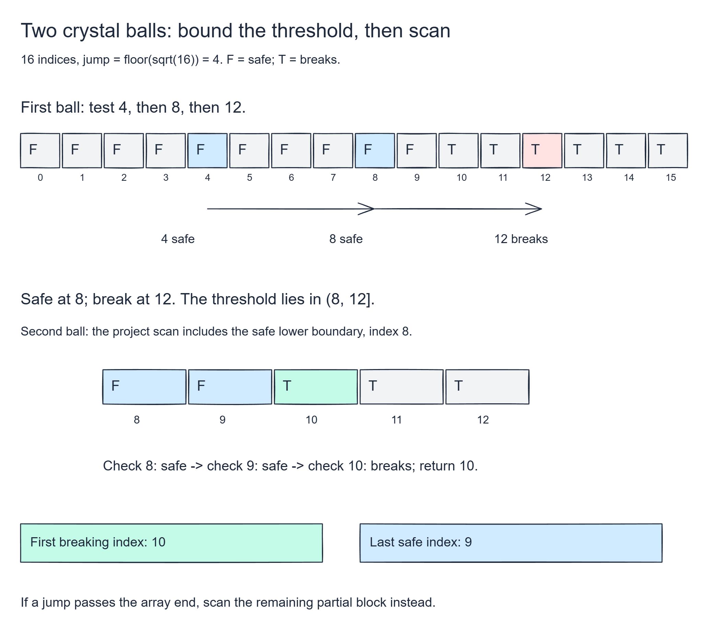

# Two Crystal Balls

A breaking threshold is the first floor index at which a dropped ball breaks. The implementations represent floors as a boolean array with a false prefix followed by a true suffix, and return the first true index or `-1` if none exists. The [problem statement](QUESTION.md) describes the highest safe floor; when a breaking index `b` exists, the last safe index is `b - 1`. If `b` is zero, no represented floor is safe. If no ball breaks in a nonempty building, the last safe index is `n - 1`.

## How it works

Choose a jump size near `sqrt(n)`. Test indices `jump`, `2 * jump`, and so on with the first ball until it breaks or you pass the end. Then scan from the preceding jump position through the breaking position, bounded by the array length. The second ball can find the first true entry within that block.



For 16 floors with the first true entry at index 10, the jump size is 4. Test 4 and 8 without breaking, then break at 12. Scan indices 8, 9 and 10 to return 10. Retesting the safe lower boundary matches the project code; beginning at the next index would also work after a confirmed safe drop.

```c
twoCrystalBalls(breaks) {
    n = length(breaks);
    jump = max(1, floor(sqrt(n)));
    index = jump;
    while (index < n && !breaks[index]) {
        index += jump;
    }
    end = min(index + 1, n);
    for (candidate = index - jump; candidate < end; candidate++) {
        if (breaks[candidate]) {
            return candidate;
        }
    }
    return -1;
}
```

After a safe jump, monotonicity rules out earlier floors as breaking positions. At a breaking jump, the threshold lies after the previous safe position and at or before the current one. If you pass the end, only the final partial block remains unchecked. Scanning the remaining block in ascending order returns its first true entry. For small arrays, scan from index zero; an empty array returns `-1`. A nonmonotonic boolean array violates the assumption and can lead to missed true entries.

## Costs and project code

With jump size `j`, the worst-case work is `O(n / j + j)`. Choosing `j` near `sqrt(n)` balances the jump and scan phases, giving `O(sqrt(n))` time for nonempty arrays and `O(1)` auxiliary space. The input remains unchanged.

This fixed-jump strategy meets that asymptotic bound. It does not minimize the exact worst-case drop count: a decreasing jump schedule can improve the constant. The existing statement's claim of a minimum should be read with that distinction.

Python and TypeScript enforce a minimum jump of one. Go handles an empty array before scanning and uses the square root for nonempty arrays. All three return a zero-based breaking index, not a one-based floor label.

Code: [Go](golang/solution.go), [Python](python/solution.py) and [TypeScript](typescript/index.ts).

## Complexity derivation

Let `n` count represented floors and `j = max(1, floor(sqrt(n)))` for nonempty input. At most `O(n/j)` jump probes and `j + 1` scan probes occur. An all-safe array forces the jump phase to cross the building and supplies an `Ω(n/j)` lower bound; with this choice of `j`, worst-case time is therefore `Θ(sqrt(n))`. The algorithm reads selected entries directly; it does not first copy or scan the full input array.

For `n = 16` and first breaking index 10, the actual read indices are `4, 8, 12, 8, 9, 10`. The repeated read of 8 belongs to the linear phase and counts as another probe. A threshold at index zero can return after a constant number of probes, so best-case time is `Θ(1)`. Empty input also takes constant time and returns `-1`. Jump, index and loop state use `Θ(1)` auxiliary and call-stack space. This is the cost of the fixed-jump implementation, not a proof of exact optimality among all two-ball strategies.
