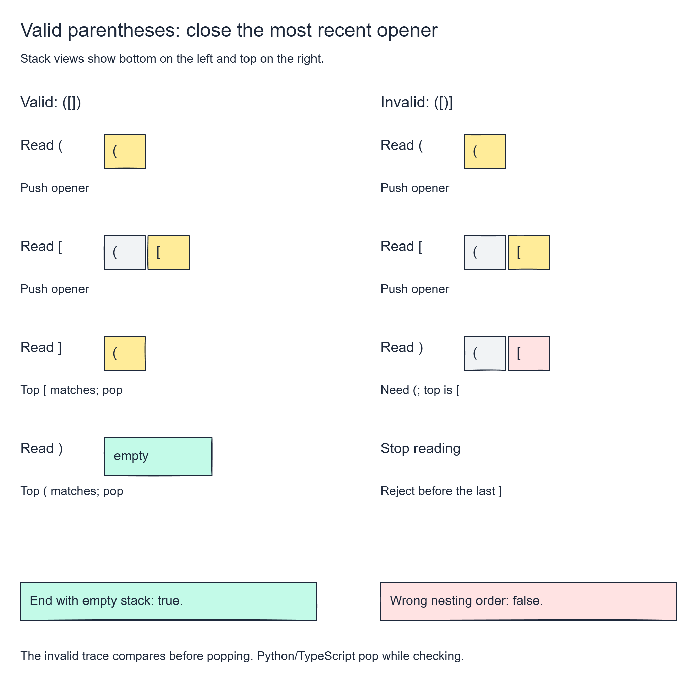

# Valid Parentheses

A valid bracket string pairs each opening bracket with a closing bracket of the same type and closes inner pairs before outer pairs. Determine whether a string containing `()[]{}` follows those rules. See the [problem statement](QUESTION.md).

## How it works

Use a stack of unmatched opening brackets. Push an opener when you read it. At a closer, compare against the most recent unmatched opener, which is the stack's top. An empty stack or a different bracket type means failure. Consume the matching opener and continue. After the last character, require an empty stack.



For `([])`, push `(`, then `[`. The `]` consumes `[`, and the `)` consumes `(`, leaving no unmatched opener. For `([)]`, the first closer is `)`, but the top is `[`. Reject it at that point. Counts of openers and closers would balance here, but the nesting order is wrong.

```c
isValid(s) {
    stack = [];
    pairs = {')': '(', ']': '[', '}': '{'};
    for (i = 0; i < length(s); i++) {
        current = s[i];
        if (current == '(' || current == '[' || current == '{') {
            stack.push(current);
        } else {
            if (stack.empty() || stack.top() != pairs[current]) {
                return false;
            }
            stack.pop();
        }
    }
    return stack.empty();
}
```

After a valid prefix, the stack contains its unmatched openers from outermost to innermost. Pushing opens a nested pair. Matching and popping the top closes the innermost pair, preserving that condition. An unmatched closer violates it at once. Remaining openers at the end mean missing closers, so `"(("` returns false. The empty string returns true in the implementations, though the statement requires a nonempty input.

## Costs and project code

For `n` characters, time is `O(n)` and auxiliary space is `O(n)` in the worst case, such as an input containing only openers. Each character causes at most one push or pop. The input remains unchanged.

Go compares before popping. Python and TypeScript pop while checking, and return false on a mismatch or missing opener. Those variants make the same validity decision. The implementations assume the statement's bracket-only alphabet; they do not share a contract for other characters.

Code: [Go](golang/solution.go), [Python](python/solution.py) and [TypeScript](typescript/index.ts).
